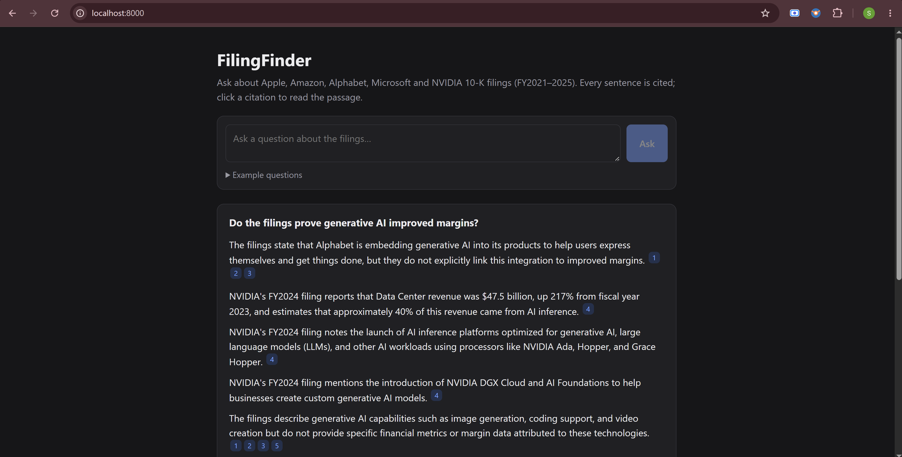
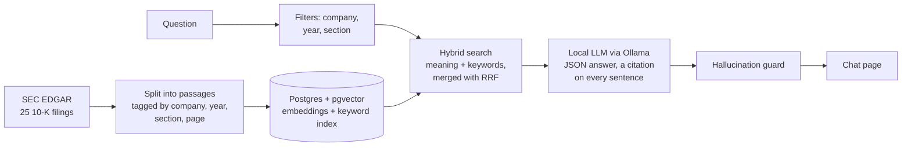

# FilingFinder

Ask plain-English questions about company annual reports (SEC 10-K filings) and get answers
where **every sentence is cited to the filing, section and page**, with the original passage
one click away. If the filings don't contain the answer, it says so instead of guessing.

A personal learning project to build retrieval-augmented generation (RAG) end to end, running
entirely on a local machine with free tools: no paid APIs, no accounts.



## What it does

- Answers questions about **Apple, Amazon, Alphabet, Microsoft and NVIDIA** 10-Ks, fiscal years 2021–2025 (25 filings).
- Cites every sentence, e.g. *Apple 10-K FY2024, Risk Factors, p. 8*; click a citation to read the exact passage, with a link to the filing on SEC EDGAR.
- Handles comparisons across companies and years by searching each company-year separately, so no company is crowded out.
- Says **"Not found in the filings"** rather than guessing, and refuses investment-advice questions ("Should I buy…").
- Runs a **hallucination guard** on every answer: sentences whose citation or figures can't be traced back to the source passage are removed, and the page shows what was removed and why.

## How it works



1. **Download** the filings from SEC EDGAR.
2. **Split** each filing into about 3,900 passages labelled with company, fiscal year, section and page.
3. **Index** them in PostgreSQL with pgvector: a 768-number embedding per passage for meaning search, plus a full-text index for exact terms.
4. **Search**: read the companies, years and sections from the question, then run vector and keyword search in each company-year and merge the results with Reciprocal Rank Fusion.
5. **Answer**: a local model (Qwen3.5 4B in Ollama) writes JSON where each sentence lists its source passages.
6. **Check**: the guard removes any sentence that has no valid citation, uses a figure that isn't in its cited passage, attaches a figure to the wrong table row or year, says "increased" when the figure went down, or claims something changed without citing two years.

## Results

Measured on this project's own test sets (`eval/`), so treat them as a small-sample check, not a benchmark.

| Check | Result |
|---|---|
| Figures in answers that match the filings (number-heavy questions) | **56 / 56 (100%)**, up from 34 / 36 (94%) before the Phase 5 guard and prompt fixes |
| Test questions behaving correctly (answered / "not found" / refused) | 14 / 14 |
| Search finds the right passage first | 10 / 17 |
| Search finds the right passage in the top 5 | 13 / 17 |
| Automated tests | 65 passing |

## Tech stack

Python · PostgreSQL 16 + pgvector · Docker Compose · sentence-transformers (`nomic-ai/modernbert-embed-base`, CPU) ·
Ollama (`qwen3.5:4b`) · FastAPI · React + Vite (JavaScript) · pytest

## Setup

Tested on Windows 10/11. Everything is free.

**Install first:** [Python 3.11+](https://www.python.org/downloads/),
[Node.js 20+](https://nodejs.org/), [Docker Desktop](https://www.docker.com/products/docker-desktop/),
[Ollama](https://ollama.com/download).

```powershell
# 1. Get the code
git clone https://github.com/saad-abid/filing-finder.git
cd filing-finder

# 2. Python environment (CPU-only PyTorch first, it's much smaller)
python -m venv .venv
.venv\Scripts\activate
pip install torch --index-url https://download.pytorch.org/whl/cpu
pip install -r requirements.txt

# 3. Settings: copy, then edit SEC_USER_AGENT (your name and email, required by SEC)
#    and pick a password (set it in both POSTGRES_PASSWORD and DATABASE_URL)
copy .env.example .env

# 4. Database
docker compose up -d

# 5. Download and split the filings (a few minutes)
python src\ingestion\download_filings.py
python src\parsing\parse_filings.py

# 6. Build the search index (one time, about 1.5 hours on a laptop CPU; safe to stop and resume)
python -m src.indexing.build_index

# 7. Download the AI model (about 3 GB)
ollama pull qwen3.5:4b
```

## Run it

```powershell
powershell -ExecutionPolicy Bypass -File .\start.ps1
```

The script checks each piece (Docker and the database, Ollama and the model, the web page),
starts anything that isn't running, explains how to fix anything missing, and opens
**http://localhost:8000**. Press **Ctrl+C** to stop.

Answers take about **3–8 minutes** on a CPU-only laptop (longer for big multi-company
comparisons); the page shows a timer, and extra questions wait in line.

<details>
<summary>Running the pieces by hand (or on macOS / Linux)</summary>

```bash
docker compose up -d
cd web && npm install && npm run build && cd ..
python -m uvicorn src.api.app:app --port 8000
```

While editing the page, also run `npm run dev` in `web/` and open http://localhost:5173.
</details>

## Command-line tools

```powershell
python -m src.retrieval.retrieve "How did NVIDIA describe export controls in fiscal 2024?"   # search only
python -m src.answer.answer "Does Apple rely on a few suppliers in 2024?" --show-passages      # full answer
python -m src.retrieval.evaluate                                                               # search accuracy
python -m src.answer.evaluate --only 1,2,5,9 --save eval/results/run.json                      # answer test set
python -m src.evaluation.scorecard eval/results/run.json                                       # grade the figures
pytest                                                                                         # automated tests
```

## Project structure

```
src/
  ingestion/   download_filings.py   download 10-Ks from SEC EDGAR
  parsing/     parse_filings.py      split filings into page- and section-tagged passages
  indexing/    enrich.py, embedder.py, build_index.py   clean labels, embed, load Postgres
  retrieval/   query_parser.py, retrieve.py             filters + hybrid search
  answer/      llm.py, prompts.py, guard.py, answer.py  local model, prompt, hallucination guard
  evaluation/  scorecard.py                             grade figures against known values
  api/         app.py, jobs.py                          FastAPI server + one-at-a-time queue
web/           React chat page (Vite)
eval/          test questions, correct figures, saved runs
db/schema.sql  database table and indexes
tests/         pytest suite
```

## Limitations

- **Speed.** A 4B model on a CPU takes minutes per answer. A machine with a supported GPU, or a hosted model, would be far faster.
- **A small model sometimes misses answers that are there.** For example, "Who manufactures NVIDIA's chips?" came back "not found" even though the passage naming TSMC was retrieved. It errs on the side of "not found" rather than inventing an answer.
- **The guard checks figures, not reasoning.** It catches invented numbers and wrong row or year labels in tables, but not every misleading sentence, and it can't read the year of a table whose header has no years.
- **Small evaluation.** The test sets are 17 search questions and 14 answer questions; the 100% figure accuracy covers about 56 figures.
- **Fixed corpus.** 25 10-K filings for five companies; it runs locally and isn't hosted online.

## Rules the project follows

Never invent facts; cite every sentence; show the passage; don't go beyond the filings
(no predictions or investment advice). A wrong confident answer is worse than "not found".
See [docs/project_brief.md](docs/project_brief.md) for the full brief and build phases.
